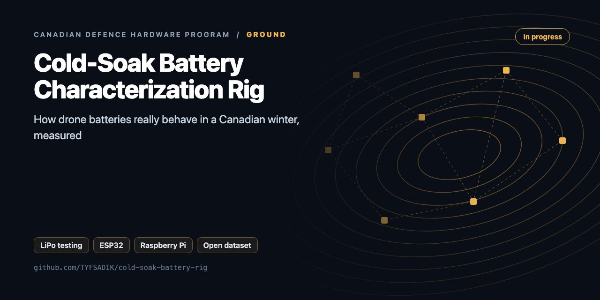
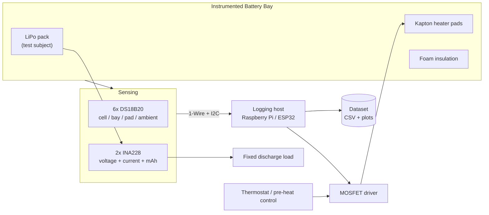

<div align="center">



# Cold-Soak Battery Characterization Rig

**Heated, instrumented drone battery bay tested in a lab freezer and real Canadian winter: runtime, voltage sag, and failure modes logged against temperature.**

[](https://github.com/TYFSADIK/cold-soak-battery-rig/actions/workflows/tests.yml)   [](LICENSE) [](https://github.com/TYFSADIK/defence-hardware-program)

[Build guide](docs/project-page.md) · [How it works](#how-it-works) · [Quick start](#quick-start) · [Program hub](https://github.com/TYFSADIK/defence-hardware-program)

</div>

## Overview

LiPo batteries hate the cold, and cold is the default operating condition for a huge share of Canadian defence scenarios. The **Army MINERVA challenges** say it plainly: bought-in foreign robotic systems have had problems with cold-weather operation, and Canada currently lacks an ISR drone that works in Arctic conditions. The **Defence Drone Initiative**, launched July 23, 2026, makes low-cost tactical drones a stated national priority.

So this build is not a drone, it is the measurement rig that tells you whether a drone's power system survives the cold. A battery bay on a quadcopter frame carries **Kapton heater pads**, foam insulation, six temperature sensors, and two power monitors. The whole bay goes into a lab freezer (and later, the actual Toronto winter), and every run logs pack voltage, discharge and heater current, accumulated mAh, and four temperature channels against time.

The deliverable is deliberately boring and valuable: a **clean, public dataset of battery behaviour versus temperature**, measured against a stated Army pain point once the full run matrix and outdoor validation are complete, with a full protocol anyone can reproduce. Vendors publish marketing numbers; hobbyists publish anecdotes; a controlled, documented dataset at 0, -10, -20, and -30 °C is rare, easy to explain, and directly useful to anyone sizing an Arctic-capable platform, including the thermal SAR drone in this same program, whose packs are the test subjects here.

## How it works



*The instrumented bay is sensed over 1-Wire and I2C; the logging host drives the heater MOSFET and writes every run to the dataset.*

## Quick start

```bash
python -m unittest -v
cd firmware/safety-cutoff && c++ -std=c++17 -Iinclude test/test_cutoff.cpp -o /tmp/t && /tmp/t
pio run -e esp32dev -t upload      # flash the ESP32
```

## What's in this repo

| Path | Language | Purpose |
|---|---|---|
| `coldsoak/thermostat.py` | Python | Hysteresis control on the pad sensor, latched cell over-temp, DS18B20 fault values (85 / -127), sensor timeout |
| `coldsoak/sensors.py` | Python | DS18B20 1-Wire and INA228 I²C drivers |
| `coldsoak/rig.py` | Python | Pi main loop: sensors, thermostat, MOSFET, heartbeat, CSV |
| `coldsoak/analysis.py` | Python | Runtime, mAh, Wh, voltage sag, heater duty, and runtime retained vs the warm baseline |
| `firmware/safety-cutoff/` | C++17 / PlatformIO | ESP32 independent cutoff (`cutoff.h` is portable and host-tested) |

## What you need

| Category | Item | Notes |
|----|----|----|
| Hardware | 6x DS18B20 temperature sensors | Powered 3-wire mode for cold runs; pull-up at the host end; serial-to-position map before taping anything down |
| Hardware | 2x INA228 power monitors | Pack voltage, current, and accumulated mAh; set distinct I2C addresses before wiring |
| Hardware | Kapton heater pads + N-MOSFET | Controlled warming with a hardware fails-off gate pull-down |
| Hardware | Chest freezer or a Canadian winter | The cold chamber; foam insulation for the battery bay |
| Hardware | Logging host + test packs | Pi or ESP32 from program stock; the LiPo packs under test come from the drone program |
| Software | 1-Wire, i2c-tools, Python | Sensor bus, bus scans after every wiring change, logging and analysis |
| Software | systemd, plotting tooling | Restart-on-failure logging; matplotlib-class tooling for the voltage-sag curves |
| Skills | Soldering, I2C debugging, basic electronics | MOSFET drive, pull-up placement, multimeter cross-checks |
| Accounts | None | No accounts or licenses required |

## Status

- **Done**: heater pads and MOSFET driver benched with fails-off gate pull-down; 1-Wire sensor harness installed in powered mode with serial-to-position map; both INA228s addressed, shunt-calibrated per the datasheet, and cross-checked against the Fluke (reported bench status; no measured dataset published yet); logging service running under systemd with restart-on-failure; room-temperature baseline and first freezer runs at the warmer setpoints logged; fixed discharge load verified against design math.
- **In progress**: repeated runs across the full setpoint ladder; thermostat-control tuning (hysteresis band and setpoint); plotting tooling for the voltage-sag curves.
- **Next**: pre-heat-and-fly matrix runs; outdoor winter validation with weather tagging; the break-even analysis; publish the dataset and full protocol.

| Metric | Target | Measured to date | Current status |
|----|----|----|----|
| Room-temperature baseline (Run 1) | 3+ repeats to bound run-to-run spread | Logged, not yet published | Done, baseline runs logged |
| Freezer ladder, unheated (Run 2) | 4 setpoints x 3 repeats | No numbers published yet | In progress, warmer setpoints logged, cold end pending |
| Freezer ladder, thermostat (Run 3) | 4 setpoints x 3 repeats | No numbers published yet | In progress, hysteresis tuning under way |
| Freezer ladder, pre-heat (Run 4) | 4 setpoints x 3 repeats | No numbers published yet | Next, follows Run 3 tuning |
| Outdoor validation (Run 5) | 2+ runs per winter condition band, weather-tagged | No data, waiting on weather | Next, waiting on sustained sub-zero weather |
| Break-even analysis (Run 6) | Net recovered capacity quantified per strategy and setpoint | No numbers published yet | Pending, derived from Runs 2-4 |
| Published dataset | CSVs + protocol + plotting code in a public repo | Not yet published | Not yet published |

## Roadmap

- [ ] Run plan: +20 °C baseline, then -10/-20/-30 °C unheated vs heated, three runs each
- [ ] Feed the measured curve into `arctic-isr-drone/isr/cold_ops.py`
- [ ] Add an internal-resistance estimate (ΔV/ΔI at load steps) per temperature
- [ ] Fire-safe enclosure (LiPo bag or ammo can) for every cold test

## Related builds

- [**Thermal Search-and-Rescue Drone**](https://github.com/TYFSADIK/thermal-sar-drone), the airframe whose LiPo packs are this rig's test subjects; the dataset tells it how much winter endurance it really has.
- [**Secure Robot-Fleet Updates**](https://github.com/TYFSADIK/secure-fleet-updates), the sibling "Cold & Trust" build, tested in the same cold chamber for cold-boot and rollback behaviour.
- [**Canadian Defence Hardware Program**](https://github.com/TYFSADIK/defence-hardware-program), the program hub: all eleven builds, full BOMs, and the defence context this rig answers.

## Safety and legal

**LiPo safety:** a LiPo bag and an ABC extinguisher live at the bench, and the rig is never left unattended while a pack is under load or on the heater. The ABC extinguisher handles ordinary fires around the rig; it will not stop cell thermal runaway once it starts. If a pack vents, the plan is evacuation first, isolate power if safe to do so, and call emergency services, following site procedures.

**Never charge a cold or frozen battery:** every cold-soak run ends with the pack warming back to room temperature before the charger connects, every run, no exceptions.

## Learn more

The full build guide, with step-by-step instructions, wiring, troubleshooting and lessons learned, is in [docs/project-page.md](docs/project-page.md). It is also published at [tyfsadik.org](https://tyfsadik.org/work/defence/cold-soak-battery-rig.html).

## License

[MIT](LICENSE). Built by [Taki Sadik](https://tyfsadik.org) as part of the self-funded [Canadian Defence Hardware Program](https://github.com/TYFSADIK/defence-hardware-program).
