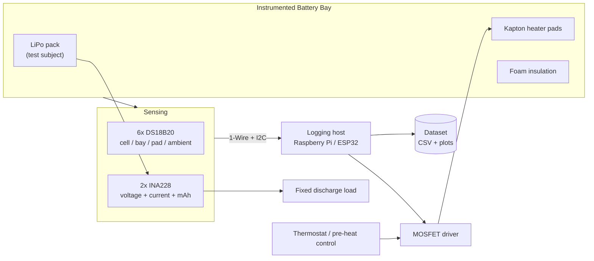
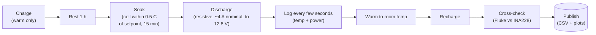

# Cold-Soak Battery Characterization Rig

Written by [Taki Sadik](https://tyfsadik.org/about.html) · Last updated 2026-10-22 · Status: Building · 32 min read

A heated, instrumented drone battery bay soaked in a lab freezer and in real Canadian winter, logging runtime, voltage sag, and failure modes against temperature, and publishing it all as a reproducible dataset.

## Overview

LiPo batteries hate the cold, and cold is the default operating condition for a huge share of Canadian defence scenarios. The **Army MINERVA challenges** say it plainly: bought-in foreign robotic systems have had problems with cold-weather operation, and Canada currently lacks an ISR drone that works in Arctic conditions. The **Defence Drone Initiative**, launched July 23, 2026, makes low-cost tactical drones a stated national priority.

So this build is not a drone, it is the measurement rig that tells you whether a drone's power system survives the cold. A battery bay on a quadcopter frame carries **Kapton heater pads**, foam insulation, six temperature sensors, and two power monitors. The whole bay goes into a lab freezer (and later, the actual Toronto winter), and every run logs pack voltage, discharge and heater current, accumulated mAh, and four temperature channels against time.

The deliverable is deliberately boring and valuable: a **clean, public dataset of battery behaviour versus temperature**, measured against a stated Army pain point once the full run matrix and outdoor validation are complete, with a full protocol anyone can reproduce. Vendors publish marketing numbers; hobbyists publish anecdotes; a controlled, documented dataset at 0, -10, -20, and -30 °C is rare, easy to explain, and directly useful to anyone sizing an Arctic-capable platform, including the thermal SAR drone in this same program, whose packs are the test subjects here.

## Bill of Materials

Everything below is purchased and on the bench; the logging host and test packs come from shared program stock.

| Part | Role | Details | Est. US\$ |
|----|----|----|----|
| Sensors | Temperature and power logging | 6 DS18B20 temperature sensors or thermocouple amps, 2 INA228 power monitors | 40-70 |
| Battery heater | Controlled warming | Kapton heater pads, logic-level N-MOSFET, foam insulation | 20-40 |
| Cold chamber | Freezing environment | A Canadian winter (free), or a cheap chest freezer | 0-300 |
| Logging host | Sampling and storage | Raspberry Pi / ESP32 from program stock | \- |
| Test subject | Cell under test | LiPo packs from the drone program | (shared) |

## Architecture

Figure 1: the instrumented bay is sensed over 1-Wire and I2C; the logging host drives the heater MOSFET and writes every run to the dataset.

One design decision shapes everything else: **the logging host never enters the cold chamber.** The Pi sits on the bench at room temperature; only the sensor leads, the heater feed, and the discharge leads pass into the freezer through the door gasket. Consumer SD cards, crystal oscillators, and USB hubs all get flaky below -20 °C, and a logger that dies at minute forty of a -30 °C soak is a wasted evening. Keeping the compute warm and the instruments cold is what makes the dataset trustworthy.

## Why Cold Steals Capacity (the Short Version)

A LiPo cell stores the same charge at -30 C as at room temperature; what changes is how fast the chemistry can **deliver** it. Cold slows ion mobility and raises internal resistance, so the same 4 A discharge drags the terminal voltage down much harder. The run ends not when the chemistry is empty, but when the sagging voltage hits the 12.8 V cutoff early, capacity is left stranded behind that wall. Two effects fight back. Discharge itself **self-heats** the cell (resistive heating is unavoidable), which can partially recover the curve mid-run; and a heater pad can keep the cell warm, but its energy comes from a battery too, so the honest question is never "does heating help", it is "does heating help **net of its own cost**". Run 6 exists to answer exactly that, and the heater-branch INA228 measures the cost so nobody has to guess. Cold derating is not a single number: it depends on cell chemistry, discharge C-rate, pack age, state of charge, and thermal history, which is exactly why this rig measures it per pack instead of quoting a generic derating factor.

One hard rule the page already states, and worth repeating: never charge a cold pack. Charging lithium below freezing plates lithium metal onto the anode, permanently and dangerously; every run in the matrix warms the pack to room temperature before recharge.

## Wiring & Connections

| From | To | Cable or interface | Notes |
|----|----|----|----|
| DS18B20 harness (VDD, GND, DATA) | Pi GPIO4 (pin 7), 3V3 (pin 1), GND (pin 6) | 1-Wire bus, 3-conductor 22 AWG | Powered 3-wire mode, 4.7 kΩ pull-up between 3V3 and DATA at the Pi end; leads pass through the freezer door gasket |
| INA228 \#1 (discharge path) | Pi I2C1: SDA (pin 3), SCL (pin 5) | I2C, address 0x40 | A0/A1 tied to GND; sits in series between the pack and the fixed load |
| INA228 \#2 (heater branch) | Same I2C1 bus | I2C, address 0x41 | A0 tied to VS+ to move it off 0x40; measures heater voltage, current, and mAh separately |
| Pi GPIO17 (pin 11) | MOSFET gate | Gate signal wire | 100 Ω series resistor at the gate, 10 kΩ pull-down to GND so the heater fails off during boot |
| 4S pack positive | Kapton pads positive | 18 AWG silicone, 5 A fuse inline | Fuse within 5 cm of the pack lead; heater energy comes from the pack itself, like a real aircraft |
| MOSFET drain | Kapton pads negative | 18 AWG silicone | Source to common GND shared with the Pi; low-side switching |
| Pack discharge lead (XT60) | Load resistor bank | 14 AWG silicone | Load mounted on a heatsink outside the bay, a 60+ W heat source inside the bay would corrupt the thermal data |
| Bench USB-C wall power | Pi 5 V rail | Official 27 W USB-C supply | The Pi stays on the bench at room temperature for every run |

## How I Built It

The battery bay on the quadcopter frame gets the full treatment: Kapton heater pads bonded flat against the bay walls with polyimide tape, a logic-level N-MOSFET switching the pads on the low side, and foam insulation wrapped around the whole bay. The insulation is not there to keep the pack warm for free, it is there to make the heat budget *measurable*, so watts in maps predictably to degrees gained instead of leaking into the freezer.

Safety and failure behaviour are designed in, not added on: a fuse within centimetres of the pack lead, and a gate pull-down so the heater is physically off until software says otherwise. If the Pi crashes mid-run, the rig defaults to a cold, passive pack, never to a runaway heater in an insulated box.

**Heater driver wiring, logic-level n-mosfet**

    N-MOSFET with Rds(on) specified at Vgs = 2.5 V (3.3 V GPIO drive)
      Gate   -> GPIO17 (Pi pin 11) via 100 ohm series resistor
      Gate   -> 10 kohm pull-down to GND   (fails OFF at boot)
      Drain  -> Kapton pads (-)
      Source -> GND (common with Pi ground)
    Kapton pads (+) -> 4S pack (+) via 5 A fuse
    Heater feed measured by INA228 #2 on the high side

**Why not the classic IRLZ44N:** its Vgs(th) of 1-2 V is only the onset of conduction, not proof of low-resistance enhancement at 3.3 V GPIO; its datasheet Rds(on) is specified at 4 V and 10 V gate drive. This rig needs a MOSFET whose datasheet table explicitly lists Rds(on) at 2.5 V Vgs, or a proper gate driver, otherwise the heater current runs through a half-on MOSFET.

**What can go wrong:** bonding pads before testing them is the classic mistake, I bench-ran each pad through the MOSFET first and checked for even heating by hand (and against the Fluke's thermocouple) before anything got taped down permanently.

Six DS18B20 sensors go where the physics actually happens: taped to the cell surface, on the bay wall, directly on the heater pad, in ambient air inside the freezer, plus two spares for cross-checking. All six share one 1-Wire bus on GPIO4 with a single 4.7 kΩ pull-up, in powered 3-wire mode, parasite power over long freezer leads is asking for dropouts.

The Pi reads them through the kernel's `w1-therm` driver, which exposes each probe as a file under `/sys/bus/w1/devices/`. Reading a sensor is literally `cat`-ing a file, no libraries, no daemons, and nothing to debug at -30 °C. Know the accuracy bands from the datasheet: the DS18B20's ±0.5 °C figure applies only from -10 to +85 °C; from -30 to +100 °C it is ±1 °C, and across the full -55 to +125 °C range it is ±2 °C. The ±0.5 °C soak-stability band at -20 or -30 °C is therefore a repeatability and stability requirement, not uncalibrated absolute accuracy, and cold-setpoint runs need calibration against a reference at the soak temperature.

**Enable 1-wire, /boot/firmware/config.txt**

    dtoverlay=w1-gpio,gpiopin=4

**Verify all six probes enumerate and read**

    $ sudo modprobe w1-gpio && sudo modprobe w1-therm
    $ ls /sys/bus/w1/devices/
    28-00000a4f11c3  28-00000a51e907  28-00000b02d44a
    28-00000b7c31e8  28-00000c19f0b2  28-00000c52aa61
    w1_bus_master1
    $ cat /sys/bus/w1/devices/28-00000a4f11c3/temperature
    21375

**How I verified:** each sensor got a warm finger while watching its file, that maps serial number to physical position, and the mapping is written into the logger config. A sensor stuck at exactly 85.000 °C is the DS18B20's power-on default and means the last conversion failed, i.e. a wiring problem, not a coincidence.

Two INA228 power monitors do the electrical accounting. One sits in series between the pack and the discharge load and logs bus voltage, shunt current, and accumulated charge; the second sits in the heater feed, so the energy spent on heating is costed separately from the energy delivered to the load. That separation is what makes the heater-strategy comparison in step 09 honest instead of hand-wavy.

Both chips share the Pi's I2C1 bus, so the second one needs its address moved off the 0x40 default by tying A0 to VS+ (0x41), which matches the INA228 datasheet's address-strapping table (A0 at VS+ with A1 at ground selects 0x41). The INA228 monitors bus voltage through 85 V with a 20-bit delta-sigma ADC, specified at ±1 µV maximum offset and ±0.05% maximum gain error; those figures only hold with a real shunt calibration, so the shunt value and maximum expected current are written to the calibration register, not left at defaults.

**Confirm both chips on the bus**

    $ sudo i2cdetect -y 1
         0  1  2  3  4  5  6  7  8  9  a  b  c  d  e  f
    40: 40 41 -- -- -- -- -- -- -- -- -- -- -- -- -- --

**Ina228 init + calibration (python / smbus2)**

    from smbus2 import SMBus

    ADDR    = 0x40        # discharge monitor; heater monitor is 0x41
    R_SHUNT = 0.002       # 2 mOhm shunt on the breakout board
    I_MAX   = 25.0        # worst-case expected current, A
    CURRENT_LSB = I_MAX / 2**19

    bus = SMBus(1)

    def wr16(reg, val):
        bus.write_i2c_block_data(ADDR, reg, [(val >> 8) & 0xFF, val & 0xFF])

    # ADC_CONFIG (0x01): continuous shunt+bus, 4.12 ms conversions, 16x averaging
    wr16(0x01, (0xF << 12) | (0x7 << 9) | (0x7 << 6) | (0x7 << 3) | 0x2)
    # SHUNT_CAL (0x02) = 13107.2e6 * CURRENT_LSB * R_SHUNT   (ADCRANGE = 0)
    wr16(0x02, int(13107.2e6 * CURRENT_LSB * R_SHUNT) & 0x7FFF)

**How I verified:** the Fluke went in series with the load for a full discharge at room temperature; the INA228's current track had to agree before any cold data counted. What can go wrong: a swapped shunt sense lead gives perfectly smooth *negative* current readings, plausible-looking garbage, which is worse than no data.

The logger is a small Python service on the Pi: each sensor sweep reads all six `w1-therm` files and both INA228s, integrates current into accumulated mAh, and appends one timestamped row to the run's CSV on the Pi's NVMe drive. One flat CSV per run, one schema for the whole dataset, no database, because a dataset people can open in anything is a dataset people actually check. A full sweep lands about once every few seconds: the DS18B20 needs up to 750 ms per conversion at 12-bit resolution, so six sequential reads through the kernel driver cannot sustain a true 1 Hz cadence, and the logger does not pretend otherwise.

It runs under `systemd` with `Restart=always`, because freezer sessions are long and unattended: if the process dies at hour two of a soak, it comes back and keeps appending to the same run file instead of silently losing the night.

**Csv schema, one row per sensor sweep, one file per run**

    timestamp,setpoint_c,strategy,v_pack,a_discharge,mah_discharge,v_heater,a_heater,mah_heater,t_cell,t_bay,t_pad,t_ambient,run_id
    2026-09-14T21:03:12-04:00,-20,thermostat,16.71,4.02,3.4,16.68,1.21,0.9,-19.8,-18.2,-12.5,-20.1,run-014

**/etc/systemd/system/coldsoak-logger.service**

    [Unit]
    Description=Cold-soak battery logger
    After=network.target

    [Service]
    ExecStart=/usr/bin/python3 /home/taki/coldsoak/logger.py --out /data/coldsoak
    WorkingDirectory=/home/taki/coldsoak
    Restart=always
    RestartSec=5

    [Install]
    WantedBy=multi-user.target

    $ sudo systemctl enable --now coldsoak-logger
    $ journalctl -u coldsoak-logger -f

**How I verified:** I killed the process mid-run on purpose (`sudo kill -9`) and confirmed the service restarted and resumed appending without corrupting the header or duplicating rows. One edge remains: a kill landing mid-write can leave a torn final row, so downstream parsing must reject any row that does not parse to the full schema. What can go wrong: logging to the SD card instead of NVMe fills or wears the card during multi-hour runs, the dataset lives on the NVMe from day one.

The thermostat strategy is a hysteresis (bang-bang) controller: heat on when the pad sensor falls below the band, off when it rises above it. Hysteresis instead of a single threshold keeps the MOSFET from chattering at the boundary, which both wears nothing mechanical but does pollute the current trace with switching noise the INA228 then has to average out.

Two independent protections sit outside the strategy logic: a hard cutoff that forces the heater off if the *cell* sensor ever exceeds a safe limit, and a watchdog that cuts heat if sensor reads go stale, a crashed loop must equal a cold heater, matching the hardware fails-off from step 01.

**Hysteresis thermostat loop (gpiozero)**

    from gpiozero import OutputDevice
    import time

    heater = OutputDevice(17, active_high=True, initial_value=False)
    SETPOINT, HYST = 15.0, 1.5     # pad temperature band, deg C
    CELL_HARD_LIMIT = 45.0         # cell surface hard cutoff, deg C
    SENSOR_MIN, SENSOR_MAX = -55.0, 125.0   # DS18B20 valid range
    MAX_STALE_S = 10.0             # a sensor that stops updating is a failed sensor

    def reading_ok(t, ts):
        if t is None or ts is None:
            return False
        if time.time() - ts > MAX_STALE_S:
            return False           # stale: the sensor is not updating
        if abs(t - 85.0) < 0.001:
            return False           # DS18B20 power-on default: the last conversion failed
        return SENSOR_MIN <= t <= SENSOR_MAX

    def control(t_pad, ts_pad, t_cell, ts_cell):
        if not reading_ok(t_cell, ts_cell) or t_cell > CELL_HARD_LIMIT:
            heater.off()           # stale, invalid, or hot: always off
        elif not reading_ok(t_pad, ts_pad):
            heater.off()           # no valid pad reading: always off
        elif t_pad < SETPOINT - HYST:
            heater.on()
        elif t_pad > SETPOINT + HYST:
            heater.off()

**How I verified:** the loop was exercised with the pad sensor in ice water and then under a hair dryer, watching the GPIO state flip at both band edges, no battery involved. What can go wrong: the pad sensor responds faster than the cell surface, so a naive setpoint on the pad overshoots the cell temperature; that is exactly why the hard limit reads the cell, not the pad.

Every comparison in the dataset is only meaningful if the load is identical across runs, so the pack discharges through a fixed resistive bank sized for roughly three-quarter-C draw on the 5200 mAh drone packs (~4 A), close to a cruise-level pull rather than a full-throttle burst. The bank is series-wired chassis-mount power resistors bolted to a heatsink, and it lives *outside* the insulated bay: a 60-watt heater inside the bay would be the single best way to destroy the dataset's credibility.

**Load sizing (4s pack, ~4 a nominal, not constant current)**

    Target draw: ~0.77C on the 4S 5200 mAh packs (three-quarter C) -> ~4 A nominal
    R = V / I = 16.0 V / 4.0 A = 4 ohm
    P = V * I = 16.0 V * 4.0 A = 64 W
    Build: 4x 1 ohm 25 W chassis-mount resistors in series (100 W total rating)
           bolted to a finned heatsink, mounted outside the bay
    Reality: a resistor is not a constant-current load; current falls with pack
           voltage, about 4.2 A at 16.8 V down to 3.2 A at the 12.8 V cutoff.
           Watt-hours is therefore the comparison metric across runs, not amps.
    Cutoff: logger flags pack <= 12.8 V (3.2 V/cell), and an independent
           hardware undervoltage disconnect on the load backs the flag, a
           software flag alone is not a cutoff

**How I verified:** before trusting the INA228 at all, the actual draw went through the Fluke in series at room temperature, measured current has to match the design math within tolerance or the resistor bank gets re-checked. What can go wrong: resistor values drift when hot; the bank is rated 100 W against 64 W dissipated, but power-resistor ratings assume a proper heatsink, so the bank is bolted to one and gets a warm-up settle before logging starts, so early-run current matches late-run current.

Each run soaks a fully charged pack in the freezer at a fixed setpoint, 0, -10, -20, -30 °C, and waits until the **cell-surface sensor** (not the freezer's air, not the freezer's own display) has held within half a degree of the target for fifteen consecutive minutes. That half-degree band is a stability and repeatability criterion, not a claim of uncalibrated absolute accuracy at -30 °C (see the DS18B20 accuracy bands in step 02); it is enforced with cold-reference calibration, not assumed from the datasheet. The core temperature is what the chemistry feels; air temperature in a frost-free freezer swings several degrees with the defrost cycle, which is precisely why the freezer's thermostat is never part of the criterion.

Only then does the load connect, and the logger captures the full discharge: initial voltage sag under load, any recovery as the discharge self-heats the cell, runtime to the 12.8 V cutoff, and how the cutoff behaves, a graceful knee or a hard cliff.

**Soak criterion check (runs on the pi, watches the cell sensor)**

    #!/usr/bin/env bash
    # Soak = cell sensor within +/-0.5 C of setpoint for 15 straight minutes
    CELL=/sys/bus/w1/devices/28-00000a4f11c3/temperature
    TARGET=-20; TOL=0.5; HOLD=900; STABLE=0
    while :; do
      T=$(awk '{print $1/1000}' "$CELL")
      OK=$(awk -v t="$T" -v g="$TARGET" -v e="$TOL" \
           'BEGIN{print (t > g-e && t < g+e) ? 1 : 0}')
      [ "$OK" = 1 ] && STABLE=$((STABLE+10)) || STABLE=0
      [ "$STABLE" -ge "$HOLD" ] && { echo "soaked at $T C - connect load"; break; }
      sleep 10
    done

**What can go wrong:** trusting the freezer's front-panel display, mine reads several degrees off the air sensor at the cold end, and the defrost cycle can break a "stable" soak mid-hold. The script above resets the stability timer on any excursion, so a marginal soak simply takes longer instead of quietly passing.

The freezer is a controlled stand-in, not the real thing. The same protocol repeats outdoors through a Toronto winter, porch and balcony runs at whatever the weather delivers, to validate the freezer data against reality and to catch what a chest freezer physically cannot: wind stripping heat from the insulation, humidity and snow on the connectors, and the slow radiative chill of a clear night.

Every outdoor run gets tagged with observed weather at run start, pulled from Open-Meteo (no API key needed) and stored next to the CSV, so a windier -15 °C night is never averaged blindly against a calm one.

**Tag each outdoor run with real weather (open-meteo, north york)**

    $ curl -s "https://api.open-meteo.com/v1/forecast?latitude=43.77&longitude=-79.41&current=temperature_2m,relative_humidity_2m,wind_speed_10m,wind_gusts_10m" \
        | tee /data/coldsoak/run-021.weather.json

**How I will verify:** each outdoor run is matched against its nearest freezer setpoint curve, agreement within the run-to-run spread validates the freezer as a proxy; systematic divergence (for example, only on windy nights) becomes its own finding in the dataset. What can go wrong: melted snow wicking into sensor joints, outdoor harness joints get heat shrink and dielectric grease before the first snow run.

Three strategies run at every setpoint, three repeats each: **unheated** (the baseline), **thermostat-controlled** (the step-05 loop holds the bay through the soak and discharge), and **pre-heat-and-fly** (heat on the ground, disconnect the heater, then discharge on stored warmth, the way a real drone actually launches). The matrix lives in a config file so the runs are driven by data, not by memory.

The point is honest energy accounting: the heater-branch INA228 measures exactly how many mAh heating consumed, so each strategy is scored on *net* recovered capacity, capacity gained back from the cold minus capacity spent on heat. A heater that recovers 20% capacity but costs 25% is a worse battery, and the dataset should be allowed to say so.

**Run matrix, matrix.yaml**

    setpoints_c: [0, -10, -20, -30]
    strategies: [unheated, thermostat, preheat]
    repeats: 3
    cutoff_v: 12.8          # 3.2 V/cell on the 4S packs
    load_a: 4.0             # fixed resistive bank from step 06
    thermostat:
      setpoint_c: 15.0
      hysteresis_c: 1.5
    preheat:
      ground_minutes: 20
      disconnect_before_discharge: true

**How I verify the accounting:** after every run the pack is recharged on the balance charger, and the charger's returned mAh is cross-checked against the INA228's discharged mAh, the two should bracket the same number, and a growing gap between them flags a sick pack before it contaminates the matrix.

The end product is the dataset itself: per-run CSVs, the weather tags, the run matrix, the plotting code, and the written protocol, setpoints, soak criterion, load sizing, sensor placement, and safety rules, so anyone with a freezer and fifty dollars of sensors can reproduce or extend it. Every published figure regenerates from the raw CSVs with one script; there are no hand-edited plots, because a reviewer should be able to recompute every line on every graph.

**Plot one run (pandas + matplotlib)**

    import pandas as pd
    import matplotlib.pyplot as plt

    df = pd.read_csv("run-014.csv", parse_dates=["timestamp"])

    fig, ax1 = plt.subplots()
    ax1.plot(df["timestamp"], df["v_pack"], label="pack V")
    ax1.set_ylabel("pack voltage (V)")

    ax2 = ax1.twinx()
    ax2.plot(df["timestamp"], df["t_cell"], color="orange", label="cell C")
    ax2.set_ylabel("cell temperature (deg C)")

    fig.tight_layout()
    fig.savefig("run-014.png")

**How I will verify before publishing:** a clean-checkout test, clone the dataset repo into a fresh directory, run the plot script, and diff the regenerated figures against the published ones. If the numbers in the write-up do not fall out of the CSVs untouched, the write-up gets fixed, not the data.

## Bang-Bang with a Brain: the Hysteresis Thermostat

The heater loop is a **bang-bang controller with hysteresis**: the MOSFET is fully on or fully off, and the thresholds have a gap between them. A single threshold would chatter, flicking the heater on and off every time the pad sensor wiggles across the line; hysteresis says "turn on below X, stay on until Y, then stay off until X again", which keeps the duty cycle sane. The control sensor is the **pad sensor** (fast, local, the thing the heater can actually overheat), while the safety cutoff watches the **cell-surface sensor** (slow, the thing that matters). Two sensors, two jobs: control chases the pad, safety guards the cell. And the gate pull-down means a crashed Pi cannot leave the heater on inside an insulated box.

## Testing & Metrics

The protocol is fixed before the numbers are collected, so the results, whatever they turn out to be, mean something. Every run follows the same skeleton: charge, rest, soak (or weather), discharge at the fixed load, log everything, warm to room temperature, recharge, cross-check.

### Run Plan

1.  **Run 1, Room-temperature baseline.** Setup: pack charged to 16.8 V, rested one hour at room temperature, no heater. Procedure: discharge through the fixed 4 A bank to the 12.8 V cutoff while logging. Metric: delivered mAh, runtime, and the reference V(t) curve, every later run is normalized against this one.
2.  **Run 2, Freezer ladder, unheated.** Setup: soak per the step-07 criterion at 0, -10, -20, and -30 °C. Procedure: identical discharge to Run 1. Metric: runtime and delivered capacity vs. setpoint, initial sag depth, self-heating recovery, and the failure mode (graceful knee vs. hard cliff) at each temperature.
3.  **Run 3, Freezer ladder, thermostat.** Setup: same ladder, thermostat loop active through soak and discharge. Procedure: identical discharge. Metric: capacity recovered vs. Run 2, plus heater mAh from INA228 \#2, the net gain or loss per setpoint.
4.  **Run 4, Freezer ladder, pre-heat-and-fly.** Setup: same ladder; heater warms the pack for the configured ground time, then disconnects. Procedure: discharge on stored warmth. Metric: capacity vs. Run 3 at zero in-flight heating cost, and how fast the bay bleeds heat after disconnect.
5.  **Run 5, Outdoor winter validation.** Setup: porch/balcony runs at real conditions, weather-tagged per step 08. Procedure: identical discharge. Metric: agreement between outdoor curves and the nearest freezer setpoint, this validates (or indicts) the freezer as a proxy.
6.  **Run 6, Heater energy accounting.** Setup: aggregated across Runs 3-4. Procedure: heater-branch mAh vs. recovered capacity per setpoint. Metric: the break-even temperature, below which heating pays for itself, above which it does not.

Figure: the per-run skeleton every run in the matrix follows. Charge and recharge only ever happen warm; the soak criterion is measured on the cell-surface sensor, not the freezer display.

**Figure:** sizing the fixed discharge load from the page's own numbers: ~4 A on a 4S pack (~16 V) means ~64 W of dissipation, so the bank of four 1 ohm 25 W resistors in series (100 W rating) carries it with headroom. The load sits on a heatsink outside the bay, since a 60+ W heat source inside would corrupt the thermal data.

### Targets, Measured Evidence, and Current Status

Honest bookkeeping: targets and progress states only. No measured numbers are published until the full matrix and the outdoor validation are complete.

| Metric | Target | Measured to date | Current status |
|----|----|----|----|
| Room-temperature baseline (Run 1) | 3+ repeats to bound run-to-run spread | Logged, not yet published | Done, baseline runs logged |
| Freezer ladder, unheated (Run 2) | 4 setpoints x 3 repeats | No numbers published yet | In progress, warmer setpoints logged, cold end pending |
| Freezer ladder, thermostat (Run 3) | 4 setpoints x 3 repeats | No numbers published yet | In progress, hysteresis tuning under way |
| Freezer ladder, pre-heat (Run 4) | 4 setpoints x 3 repeats | No numbers published yet | Next, follows Run 3 tuning |
| Outdoor validation (Run 5) | 2+ runs per winter condition band, weather-tagged | No data, waiting on weather | Next, waiting on sustained sub-zero weather |
| Break-even analysis (Run 6) | Net recovered capacity quantified per strategy and setpoint | No numbers published yet | Pending, derived from Runs 2-4 |
| Published dataset | CSVs + protocol + plotting code in a public repo | Not yet published | Not yet published |

Freezer runs are under way; the plotted dataset is not published yet, nothing on this page reports measured numbers until the repeated runs and outdoor validation are complete.

## Troubleshooting & Lessons

- **Every sensor read exactly 85.000 °C after wiring.** That value is the DS18B20's power-on default, not a real temperature, the bus was up but conversions were failing because the pull-up was at the far end of a long harness. Fix: moved the 4.7 kΩ pull-up to the Pi end. Lesson: finger-test every sensor and log the serial-to-position map *before* taping anything into the bay.
- **Sensors vanished mid-run at freezer temperatures.** Parasite power over long cold leads dropped the bus under load. Fix: rewired to powered 3-wire mode (VDD to 3V3) and shortened stub lengths. Lesson: parasite power is for short bench runs, not for a metre of wire into a -30 °C box.
- **The heater came on for a second during Pi boot.** The GPIO floats until the OS configures it, and the MOSFET gate happily followed the float. Fix: the 10 kΩ gate pull-down from step 01. Lesson: hardware fails-off first, software safety second, the control loop should never be the only thing between a LiPo and an unattended heater.
- **Condensation attacked the bay on pull-out.** Taking a -20 °C bay into room air frosts it instantly, and frost inside foam insulation becomes water inside foam insulation. Fix: the whole bay goes into a sealed bag before it leaves the cold, and warms up inside the bag, which dovetails with the never-charge-cold rule, since the pack cannot charge until it has warmed anyway.
- **Both INA228s answered on 0x40.** Two identical breakouts, one default address, the bus scans were chaos until A0 on the heater monitor went to VS+ for 0x41. Lesson: run `i2cdetect -y 1` after every wiring change, not just when something breaks.

## Safety & Canada Notes

**LiPo safety:** a LiPo bag and an ABC extinguisher live at the bench, and the rig is never left unattended while a pack is under load or on the heater. The ABC extinguisher handles ordinary fires around the rig; it will not stop cell thermal runaway once it starts. If a pack vents, the plan is evacuation first, isolate power if safe to do so, and call emergency services, following site procedures.

**Never charge a cold or frozen battery:** every cold-soak run ends with the pack warming back to room temperature before the charger connects, every run, no exceptions.

## Status & Roadmap

- **Done**: heater pads and MOSFET driver benched with fails-off gate pull-down; 1-Wire sensor harness installed in powered mode with serial-to-position map; both INA228s addressed, shunt-calibrated per the datasheet, and cross-checked against the Fluke (reported bench status; no measured dataset published yet); logging service running under systemd with restart-on-failure; room-temperature baseline and first freezer runs at the warmer setpoints logged; fixed discharge load verified against design math.
- **In progress**: repeated runs across the full setpoint ladder; thermostat-control tuning (hysteresis band and setpoint); plotting tooling for the voltage-sag curves.
- **Next**: pre-heat-and-fly matrix runs; outdoor winter validation with weather tagging; the break-even analysis; publish the dataset and full protocol.

## Related Builds

- [**Thermal Search-and-Rescue Drone**](https://github.com/TYFSADIK/thermal-sar-drone), the airframe whose LiPo packs are this rig's test subjects; the dataset tells it how much winter endurance it really has.
- [**Secure Robot-Fleet Updates**](https://github.com/TYFSADIK/secure-fleet-updates), the sibling "Cold & Trust" build, tested in the same cold chamber for cold-boot and rollback behaviour.
- [**Canadian Defence Hardware Program**](https://github.com/TYFSADIK/defence-hardware-program), the program hub: all eleven builds, full BOMs, and the defence context this rig answers.

## Build Narrative: Phase by Phase

**Phase 1: heater driver, fails-off first.** Kapton heater pads driven by a logic-level N-MOSFET, with a 10 k pull-down on the gate so the heater cannot fire during Pi boot when the GPIO floats. Hardware fails-off first, software safety second: the control loop is never the only thing between a LiPo and an unattended heater.

**Phase 2: temperature harness.** Six DS18B20 sensors wired in powered 3-wire mode (parasite power was abandoned after sensors vanished mid-run on long cold leads), with the 4.7 k pull-up at the Pi end of the harness. Every sensor was finger-tested and its serial number mapped to a physical position before anything was taped into the bay.

**Phase 3: power monitors.** Two INA228 power monitors on the I2C bus, addressed 0x40 and 0x41 (A0 strapped to VS+ on the heater monitor after both breakouts answered on the default 0x40). Both were calibrated and cross-checked against the Fluke multimeter, and `i2cdetect -y 1` runs after every wiring change.

**Phase 4: logging service.** A logging service under systemd with restart-on-failure records pack voltage, discharge and heater current, accumulated mAh, and the temperature channels against time. Room-temperature baselines and the first freezer runs at the warmer setpoints are already logged.

**Phase 5: protocol and tooling.** The run protocol covers 0, -10, -20, and -30 C setpoints with repeated runs per setpoint, thermostat hysteresis tuning, and plotting tooling for the voltage-sag curves. The deliverable is a clean public dataset of battery behaviour versus temperature, reproducible from the published protocol.

## What You Need

The rig is deliberately boring: a freezer, sensors, and discipline. The most important item is the protocol, not the parts.

| Category | Item | Notes |
|----|----|----|
| Hardware | 6x DS18B20 temperature sensors | Powered 3-wire mode for cold runs; pull-up at the host end; serial-to-position map before taping anything down |
| Hardware | 2x INA228 power monitors | Pack voltage, current, and accumulated mAh; set distinct I2C addresses before wiring |
| Hardware | Kapton heater pads + N-MOSFET | Controlled warming with a hardware fails-off gate pull-down |
| Hardware | Chest freezer or a Canadian winter | The cold chamber; foam insulation for the battery bay |
| Hardware | Logging host + test packs | Pi or ESP32 from program stock; the LiPo packs under test come from the drone program |
| Software | 1-Wire, i2c-tools, Python | Sensor bus, bus scans after every wiring change, logging and analysis |
| Software | systemd, plotting tooling | Restart-on-failure logging; matplotlib-class tooling for the voltage-sag curves |
| Skills | Soldering, I2C debugging, basic electronics | MOSFET drive, pull-up placement, multimeter cross-checks |
| Accounts | None | No accounts or licenses required |

## Challenges and Lessons Learned

- **Every sensor read exactly 85.000 C after wiring.** That is the DS18B20 power-on default, not a temperature: conversions were failing because the pull-up sat at the far end of a long harness. Lesson: move the pull-up to the Pi end, and finger-test every sensor before taping it in.
- **Sensors vanished mid-run at freezer temperatures.** Parasite power over long cold leads dropped the bus under load. Lesson: parasite power is for short bench runs; cold runs get powered 3-wire mode and short stubs.
- **The heater came on for a second during Pi boot.** The GPIO floats until the OS configures it, and the MOSFET gate followed the float. Lesson: hardware fails-off first (the 10 k gate pull-down), software safety second.
- **Condensation attacked the bay on pull-out.** A -20 C bay into room air frosts instantly, and frost inside foam insulation becomes water inside foam insulation. Lesson: the bay goes into a sealed bag before leaving the cold and warms up inside it, which dovetails with the never-charge-cold rule.
- **Both INA228s answered on 0x40.** Two identical breakouts, one default address. Lesson: strap A0 for a distinct address and run `i2cdetect -y 1` after every wiring change, not just when something breaks.

## What Is Next

- Repeated runs across the full setpoint ladder (0, -10, -20, -30 C) until each point has enough repeats to be trustworthy.
- Thermostat-control tuning: hysteresis band and setpoint behaviour for the heater pads.
- Pre-heat-and-fly matrix runs: how much energy does pre-heating cost versus what it buys in usable capacity.
- Outdoor winter validation with weather tagging, taking the rig out of the freezer and into the actual Toronto winter.
- The break-even analysis: heater energy versus recovered capacity, the number that decides whether cold-weather heating is worth it.
- Publish the dataset and the full protocol so anyone can reproduce the curves.

## Frequently Asked Questions

That value is the DS18B20's power-on default, not a real temperature, the bus was up but conversions were failing because the pull-up was at the far end of a long harness. Fix: moved the 4.7 kΩ pull-up to the Pi end. Lesson: finger-test every sensor and log the serial-to-position map before taping anything into the bay.

Parasite power over long cold leads dropped the bus under load. Fix: rewired to powered 3-wire mode (VDD to 3V3) and shortened stub lengths. Lesson: parasite power is for short bench runs, not for a metre of wire into a -30 °C box.

The GPIO floats until the OS configures it, and the MOSFET gate happily followed the float. Fix: the 10 kΩ gate pull-down from step 01. Lesson: hardware fails-off first, software safety second, the control loop should never be the only thing between a LiPo and an unattended heater.

Taking a -20 °C bay into room air frosts it instantly, and frost inside foam insulation becomes water inside foam insulation. Fix: the whole bay goes into a sealed bag before it leaves the cold, and warms up inside the bag, which dovetails with the never-charge-cold rule, since the pack cannot charge until it has warmed anyway.

Two identical breakouts, one default address, the bus scans were chaos until A0 on the heater monitor went to VS+ for 0x41. Lesson: run i2cdetect -y 1 after every wiring change, not just when something breaks.

## Cite This Page

**Plain text**

    Taki Sadik, "Cold-Soak Battery Characterization Rig", TYFSADIK, https://github.com/TYFSADIK/cold-soak-battery-rig (accessed 2026-10-22).

**BibTeX**

    @misc{sadik-cold-soak-battery-rig,
      author  = {Sadik, MD. Taki Yasir Faraji},
      title   = {Cold-Soak Battery Characterization Rig},
      year    = {2026},
      url     = {https://github.com/TYFSADIK/cold-soak-battery-rig},
      urldate = {2026-10-22}
    }

**APA**

    Sadik, M. T. Y. F. (2026). Cold-Soak Battery Characterization Rig. TYFSADIK. https://github.com/TYFSADIK/cold-soak-battery-rig

---

Original page: <https://github.com/TYFSADIK/cold-soak-battery-rig>
